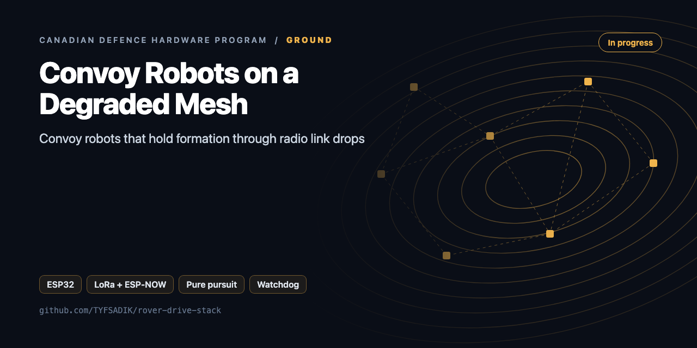
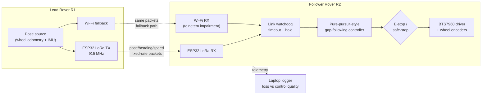

<div align="center">



# Convoy-Following Robots on a Degraded Mesh

**Two rovers convoy behind a lead vehicle over 915 MHz LoRa and Wi-Fi fallback, holding formation through link drops and recovering on reconnect.**

[](https://github.com/TYFSADIK/rover-drive-stack/actions/workflows/tests.yml)   [](LICENSE) [](https://github.com/TYFSADIK/defence-hardware-program)

[Build guide](docs/project-page.md) · [How it works](#how-it-works) · [Quick start](#quick-start) · [Program hub](https://github.com/TYFSADIK/defence-hardware-program)

</div>

## Overview

This build is a **two-rover convoy that keeps behaving when the radio link gets bad**. A lead rover drives a course while broadcasting its position, heading, and speed over a 915 MHz LoRa link (with Wi-Fi as a fallback path); the follower runs a gap-following controller that holds a set distance and offset behind it. Then I degrade the link on purpose and measure what the convoy does: how formation error grows with packet loss, how the follower behaves when the link drops entirely, and how fast it rejoins when the link comes back.

A note on the word "mesh" in the title: the demonstrated link is a point-to-point LoRa broadcast between the two rovers plus the Wi-Fi fallback, not multi-hop mesh routing. The title keeps the word because this build is the bench rehearsal for the degraded-mesh regime the seismic perimeter nodes already run in; true mesh routing on the convoy link is future work, and this page does not claim it is done.

Why this specific problem: the **Defence Drone Initiative (launched July 23, 2026)** names ground robots for resupply, casualty evacuation, and terrain too hazardous for personnel as a first-priority area, and **DRDC tests convoying and resilient operation on exercises like Operation NANOOK**. A resupply convoy that falls apart the moment the radio link degrades is useless, in the North, on a damaged road, or under deliberate interference, the link *will* degrade. The interesting engineering is not the following; it is the **denied, degraded, intermittent, and limited (DDIL) behaviour**: what the machine does in the gap between "link fine" and "link dead," and how gracefully it recovers.

## How it works



*The lead broadcasts its pose at a fixed rate over LoRa (with an impaired Wi-Fi fallback); the follower's watchdog arbitrates the link, and the controller drives through the e-stop interlock at all times.*

## Quick start

```bash
make test        # host unit tests for the firmware logic
make sim         # simulate a 6 s total link blackout and score it
make flash-lead  # needs PlatformIO
```

Real output from the demo, run on simulated data:

```text
c++ -std=c++17 -O2 -Ifirmware/lib/convoy sim/blackout_sim.cpp -o /tmp/blackout_sim && /tmp/blackout_sim > data/blackout.csv
python3 -m analysis.blackout data/blackout.csv
min_gap_m: 3.0
safe: True
transitions: [(11.0, 'FOLLOW', 'HOLD'), (14.0, 'HOLD', 'SAFE_STOP'), (16.0, 'SAFE_STOP', 'FOLLOW')]
safe_stop_at_s: 14.0
back_to_follow_s: None
```

## What's in this repo

| Path | Language | Purpose |
|---|---|---|
| `firmware/lib/convoy/packet.h` | C++17 | 26-byte state packet, CRC-16/CCITT, wrap-safe sequence numbers |
| `firmware/lib/convoy/watchdog.h` | C++17 | FOLLOW / HOLD / SAFE_STOP / REJOIN state machine (1.0 s and 4.0 s thresholds) |
| `firmware/lib/convoy/follower.h` | C++17 | Pure-pursuit steering, gap keeping, accel-limited stops, skid-steer mixing |
| `firmware/src/lead`, `firmware/src/follower` | C++ / Arduino | ESP32 + SX1276 (RadioLib) + ESP-NOW. Both links send the same bytes and the follower de-duplicates by sequence number |
| `sim/blackout_sim.cpp` | C++ | T4 blackout run on your laptop, with CSV output |
| `analysis/blackout.py` | Python | Scores a run: minimum gap, state transitions, time to SAFE_STOP and back to FOLLOW |

## What you need

| Category | Item | Notes |
|----|----|----|
| Hardware | Two rover builds | The GPS-denied rover's chassis stack, doubled: chassis, Pi 5, BTS7960, e-stops |
| Hardware | ESP32 LoRa boards | 915 MHz broadcast/receive firmware via RadioLib; Wi-Fi as the fallback path |
| Hardware | Payload dummy | Weighted cargo for the T5 payload runs |
| Software | ROS 2, pymavlink-free | Gap-following controller, watchdog state machine, bench topology monitor |
| Software | rosbag + CSV analysis | Formation error vs loss curves computed from sequence gaps in the logs |
| Software | Impairment scripts | Deliberate loss, delay, and blackout on the follower's interface; always verify with tc qdisc show before the run |
| Skills | ROS 2, control basics, RF | Pure-pursuit tuning, state-machine design, LoRa link behaviour under loss |
| Accounts | None | No accounts or licenses required |

## Status

- **Done**: both rovers built on the shared drive stack (chassis, Pi 5, BTS7960, e-stops) and driving under ROS 2 teleop; ESP32 LoRa boards flashed with the RadioLib-based broadcast/receive firmware; convoy packet format (ID, sequence, timestamp, pose, heading, speed, CRC) defined and flowing lead-to-follower; bench topology monitor showing per-link status; blackout/impairment scripts written; analysis script validated on fixtures.
- **In progress**: pure-pursuit-style gap-following controller tuning at a fixed following distance; watchdog hold-stop-rejoin state machine refinement after early grace-window testing; logging pipeline hardening (rosbag + CSV) ahead of the T1 baseline series.
- **Next**: T1 baseline clean-link laps, then the T2/T3 loss sweeps and T4 blackout runs; T5 payload runs with the weighted dummy cargo; publish following-error, recovery-time, and loss-tolerance results with the raw logs.

| Metric | Target | Current status |
|----|----|----|
| Formation gap error, clean link (T1) | Hold the set distance with sub-metre lateral error across full laps | In progress, controller tuning under way |
| Formation stability at 20% sustained loss (T2/T3) | Convoy holds formation without triggering safe-stop | In progress, impairment profiles scripted, sweep not yet run |
| Safe-stop on full link loss (T4) | Controlled stop at the hold point, no contact with the lead | In progress, watchdog state machine implemented, blackout series pending |
| Recovery time after blackout (T4) | Rejoin to within formation tolerance with no human input | In progress, analysis script validated on fixtures, awaiting run data |
| Packet-loss tolerance (T2/T3) | Characterise the sustained loss rate that forces a safe-stop | Not started, depends on completed loss sweeps |
| Payload effect (T5) | Quantify braking-distance and gap-error change under load | Not started, follows the no-payload baseline |

## Roadmap

- [ ] Wheel encoder + BNO085 odometry task on the follower (`self_pose`)
- [ ] Shared frame: initialise both rovers at surveyed start points, or use AprilTag alignment
- [ ] Log every packet RX (link, seq, RSSI, SNR) to SD and plot link-quality vs distance
- [ ] Add packet authentication (HMAC-SHA256 truncated tag, key on the device) so spoofed packets are rejected. See `secure-fleet-autonomy`
- [ ] Hardware e-stop independent of the ESP32

## Related builds

- [**Canadian Defence Hardware Program**](https://github.com/TYFSADIK/defence-hardware-program), the hub page: the full program, all eleven builds, and the shared parts phases this convoy draws from.
- [**GPS-Denied Navigation Rover**](https://github.com/TYFSADIK/gps-denied-navigation-rover), the donor build: same chassis, drive stack, and ROS 2 odometry this convoy is cloned from.
- [**DDIL-Proof DevOps**](https://github.com/TYFSADIK/ddil-proof-devops), the software-side version of the same problem: store-and-forward and graceful degradation over denied, intermittent links.
- [**Multi-Domain Common Operating Picture**](https://github.com/TYFSADIK/multi-domain-common-operating-picture), where these rovers eventually report: every node buffers through dead links and syncs on reconnect into one fused picture.

## Safety and legal

**Physical safety:** both rovers carry physical e-stop switches that cut motor power at the driver, and every convoy run happens in a clear area with nobody inside the course. A follower that misbehaves on a bad link must be stoppable by hand, instantly, that is the point of the exercise, not an inconvenience.

**Radio rules:** the LoRa hardware is 915 MHz, the correct North American / Canadian ISM band, 868 MHz parts are for Europe. Power and duty cycle stay within licence-exempt limits.

**Degraded-link testing ethics:** all link impairment is done on my own radios only: tc netem on my own Wi-Fi path, and duty-cycled transmissions from my own LoRa firmware. Nothing here jams, interferes with, or even touches anyone else's signals; jamming is illegal in Canada and would also invalidate the data.

## Learn more

The full build guide, with step-by-step instructions, wiring, troubleshooting and lessons learned, is in [docs/project-page.md](docs/project-page.md). It is also published at [tyfsadik.org](https://tyfsadik.org/work/defence/convoy-robots-degraded-mesh.html).

## License

[MIT](LICENSE). Built by [Taki Sadik](https://tyfsadik.org) as part of the self-funded [Canadian Defence Hardware Program](https://github.com/TYFSADIK/defence-hardware-program).
