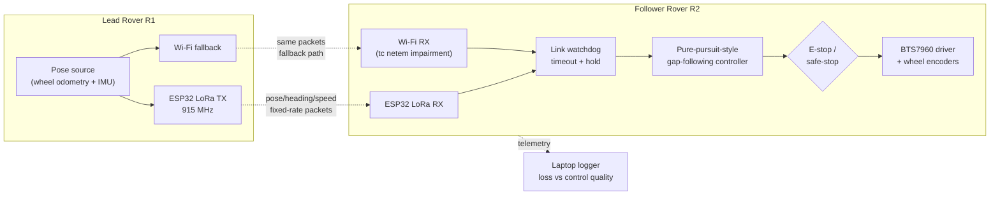

# Convoy-Following Robots on a Degraded Mesh

Written by [Taki Sadik](https://tyfsadik.org/about.html) · Last updated 2026-10-22 · Status: Building · 31 min read

Two rovers convoy behind a lead vehicle over a 915 MHz LoRa broadcast link with a Wi-Fi fallback, hold formation through induced link drops, and recover on reconnect, the Army resupply-convoy and DDIL communications problem, reproduced on my bench.

## Overview

This build is a **two-rover convoy that keeps behaving when the radio link gets bad**. A lead rover drives a course while broadcasting its position, heading, and speed over a 915 MHz LoRa link (with Wi-Fi as a fallback path); the follower runs a gap-following controller that holds a set distance and offset behind it. Then I degrade the link on purpose and measure what the convoy does: how formation error grows with packet loss, how the follower behaves when the link drops entirely, and how fast it rejoins when the link comes back.

A note on the word "mesh" in the title: the demonstrated link is a point-to-point LoRa broadcast between the two rovers plus the Wi-Fi fallback, not multi-hop mesh routing. The title keeps the word because this build is the bench rehearsal for the degraded-mesh regime the seismic perimeter nodes already run in; true mesh routing on the convoy link is future work, and this page does not claim it is done.

Why this specific problem: the **Defence Drone Initiative (launched July 23, 2026)** names ground robots for resupply, casualty evacuation, and terrain too hazardous for personnel as a first-priority area, and **DRDC tests convoying and resilient operation on exercises like Operation NANOOK**. A resupply convoy that falls apart the moment the radio link degrades is useless, in the North, on a damaged road, or under deliberate interference, the link *will* degrade. The interesting engineering is not the following; it is the **denied, degraded, intermittent, and limited (DDIL) behaviour**: what the machine does in the gap between "link fine" and "link dead," and how gracefully it recovers.

Everything here is already bought and on my bench. The chassis, compute, and drive electronics are shared with my [GPS-denied navigation rover](https://github.com/TYFSADIK/gps-denied-navigation-rover), and the LoRa boards come from the same Phase 3 mesh stock as the seismic perimeter nodes, so this build reuses proven hardware and adds the convoy link, the follow controller, and a disciplined degraded-link test protocol.

## Bill of Materials

All of this is purchased and on hand. The chassis, compute, motor driver, and power train are shared with the GPS-denied rover build, so the marginal cost of this project was mostly the LoRa boards and the follower's payload.

| Item | What I used | Est. US\$ |
|----|----|----|
| Chassis | 2 metal 4WD chassis with wheel encoders (shared with the GPS-denied rover build) | 80-150 each |
| Compute | Pi 5 8 GB per rover, active cooler | ~145 each |
| Radios | ESP32 LoRa boards, 915 MHz (from the Phase 3 mesh stock) | 20-40 each |
| Motor driver | Dual driver (BTS7960 or similar) | 20-60 |
| Payload | Dummy payload (weighted box standing in for resupply cargo) | ~0-20 |
| Power | Li-ion pack with BMS, DC-DC 5 V/5 A, physical e-stop switch | 60-100 |

## Architecture

Figure 1: the lead broadcasts its pose at a fixed rate over LoRa (with an impaired Wi-Fi fallback); the follower's watchdog arbitrates the link, and the controller drives through the e-stop interlock at all times.

Both paths carry the same packet format, so the follower does not care which radio delivered the update, the watchdog simply tracks the age of the newest good packet from either path. That is the DDIL lesson in miniature: degrade gracefully across heterogeneous links instead of betting the convoy on one of them.

## Watchdog States: the Heart of the Build

The watchdog is the only part of the follower that decides what happens to the motors, so it is worth seeing as a state machine. The controller from step 05 never sees a raw packet: it only ever receives goal points the watchdog has approved for the current state. The four states, with the thresholds straight from the firmware:

**Figure 2:** the watchdog as a state machine. FOLLOW tracks the newest packet; HOLD tracks an extrapolated vector while ramping speed down; SAFE_STOP ramps to a controlled stop and waits; REJOIN closes the gap from where the follower actually is, at half speed, instead of snapping to the lead.

### Why the grace window is a safety parameter

During HOLD the follower is driving on a prediction: where the lead *should* be, extrapolated from the last good packet. Every second of grace is a second of driving on a guess. The first version of this firmware used a 10 s grace window, and during a blackout test the follower tracked a stale vector into the lead's braking zone. The window is short now (4.0 s), and HOLD always decelerates, so the worst a guess can do is leave the follower standing still a little early. Tune this number like it controls a vehicle, because it does.

## Anatomy of a Blackout Run

The T4 blackout test is the run this build exists to survive. Here is what the design says should happen when the link drops completely mid-lap: packet age climbs from its steady 0.2 s (5 Hz broadcasts) past the 1.0 s fresh threshold into HOLD, past the 4.0 s grace threshold into a controlled SAFE_STOP, and on link restore the follower rejoins from its actual position. This diagram shows the design intent, using the watchdog thresholds from the code above; measured runs will replace it once the T4 series is logged.

## Wiring & Connections

Both rovers are wired identically, which keeps spares and debugging simple, any harness I make fits either machine. The one asymmetry is the radio role (lead broadcasts, follower listens), and that is firmware, not wiring.

| From | To | Cable / interface | Notes |
|----|----|----|----|
| Li-ion pack | BMS input | XT60, 16 AWG | BMS handles over-current and low-voltage cutoff before anything else sees power |
| BMS output | E-stop switch, then BTS7960 B+/B- | 16 AWG silicone wire | The latching e-stop sits in series with the motor supply, pressing it kills drive power regardless of software state |
| BMS output | DC-DC buck (5 V / 5 A) to Pi 5 USB-C | 18 AWG, short leads | Logic power is separate from motor power so a stalled motor cannot brown out the Pi |
| Pi 5 GPIO (PWM pins) | BTS7960 RPWM / LPWM | Dupont jumpers | Common ground between Pi and driver is mandatory; a floating ground shows up as random motor twitch |
| Pi 5 GPIO | BTS7960 R_EN / L_EN | Dupont jumpers, pull-downs | Enable lines held low until ROS bringup finishes, so the rover cannot lurch at boot |
| Wheel encoders (A/B) | Pi 5 GPIO with pull-ups | 3-wire per encoder | A swapped A/B pair reads as rotation while driving straight, caught in the taped-square check (step 01) |
| BNO085 IMU | Pi 5 I2C (SDA/SCL) | Qwiic-style cable | Same breakout as the GPS-denied rover, strapped for I2C mode here (PS0/PS1 select the protocol; the rover build uses UART). Mounted on standoffs over the chassis centreline, routed away from motor leads to keep magnetometer and gyro quiet |
| Pi 5 UART (GPIO14/15) | ESP32 LoRa board RX/TX | Dupont, cross-wired | Serial console must be disabled on the Pi first (see Troubleshooting) or the ESP32 drowns in boot messages |
| ESP32 LoRa board | 915 MHz whip antenna | SMA / u.FL coax pigtail | Never transmit without the antenna attached, an open port can damage the SX1262 power amplifier |

## How I Built It

### Step 01: Second rover: clone the proven drive stack

Rover R2 is a deliberate copy of R1: the same metal 4WD chassis with wheel encoders, a Pi 5 8 GB with an active cooler running Ubuntu 24.04, and two BTS7960 full-bridge modules (one per side). The drive stack is ROS 2 Jazzy with the same differential-drive bringup I already tuned on the GPS-denied rover: encoder ticks feed wheel odometry, and a BNO085 IMU feeds the heading estimate. Cloning first means any convoy weirdness I see later is a convoy problem, not a "why is this rover different" problem.

**Provision r2 from the r1 workspace and verify odometry**

    # On the Pi 5 (Ubuntu 24.04 Server), ROS 2 Jazzy installed per the R1 notes:
    sudo apt install ros-jazzy-ros-base python3-serial python3-gpiozero
    mkdir -p ~/convoy_ws/src && cd ~/convoy_ws/src
    git clone https://github.com/TYFSADIK/rover-drive-stack.git rover_drive
    cd ~/convoy_ws && colcon build --symlink-install
    source install/setup.bash
    ros2 launch rover_drive bringup.launch.py rover_id:=r2
    # In a second shell: encoders ticking, odometry sane
    ros2 topic echo /odom --once
    ros2 topic hz /odom        # expect a steady publish rate

**How I verified:** I drove a taped 2 m square on the floor under teleop and checked that `/odom` returned close to the origin. This is exactly how I caught a swapped encoder A/B pair on R2, the odometry reported a slow rotation while the rover drove straight, and swapping the pair in the config fixed it in minutes.

### Step 02: Flash the LoRa radios: RadioLib at 915 MHz

Each rover carries an ESP32 LoRa board (Heltec V3 / LilyGO T-Beam class, from the Phase 3 mesh stock) flashed with Arduino-IDE firmware built on the RadioLib SX1262 driver. The pin map is board-specific: the constructor in the listing is for the Heltec WiFi LoRa 32 V3, and a T-Beam needs its own NSS/DIO1/RST/BUSY values from its schematic, so one pin table does not cover both. The link deliberately runs at conservative LoRa settings, spreading factor 9, 125 kHz bandwidth, because range and robustness matter here, not throughput: a convoy update is a few dozen bytes. The same firmware image runs on both boards; a compile-time role flag decides who transmits.

**Firmware/lora_link.ino, radio init (915 mhz, sf9, bw 125 khz, cr 4/5)**

    #include <RadioLib.h>
    // Heltec WiFi LoRa 32 V3 only: NSS 8, DIO1 14, RST 12, BUSY 13.
    // LilyGO T-Beam variants use different pins, check the board schematic.
    SX1262 radio = new Module(8, 14, 12, 13);

    void setup() {
      Serial.begin(115200);   // UART to the Pi
      int state = radio.begin(915.0, 125.0, 9, 5, 18, 10, 8, 0);
      if (state != RADIOLIB_ERR_NONE) {
        Serial.printf("radio init failed: %d\n", state);
        while (true) { delay(1000); }   // fail loud, never half-init
      }
      radio.setCurrentLimit(60.0);      // 60 mA over-current protection on the PA supply,
                                      // not a licence-exempt power limit; the TX power
                                      // figure in begin() is the regulatory-relevant knob
    }

**What can go wrong:** `radio.begin` returns an error code instead of hanging silently, which is how I discovered one board in the Phase 3 stock was the 868 MHz European variant, it init'd but never linked at 915 MHz. The boards are labelled now.

**Airtime budget:** at SF9 / 125 kHz a 28-byte packet needs roughly 226 ms of airtime, so the LoRa path physically cannot carry the full 5 Hz stream (200 ms spacing). The 5 Hz cadence is what the Pi pushes over UART and what the Wi-Fi fallback carries; on the LoRa control path the firmware transmits at a sustainable lower rate. Bench target, measured with a timed transmit loop, not yet measured.

### Step 03: Define the convoy packet

The packet is the contract between lead and follower, so I fixed it before writing any controller code. It is a small packed binary struct, no JSON, no protobuf, because LoRa airtime is precious and a fixed layout is trivial to decode identically on the ESP32 (C struct) and on the Pi (Python `struct`). The two fields that matter most for degraded-link work are the sequence number (loss shows up as gaps) and the send timestamp (staleness is measurable, not guessed).

**Convoy_packet.h, identical layout on esp32 and pi**

    struct __attribute__((packed)) ConvoyPacket {
      uint8_t  magic;      // 0xC0 - cheap frame sync on the wire
      uint8_t  rover_id;   // 1 = R1 lead
      uint32_t seq;        // increments every packet: loss = gaps in seq
      uint32_t t_ms;       // sender millis() at transmit time
      float    x_m, y_m;   // lead pose in its odometry frame
      float    heading;    // radians
      float    speed;      // m/s
      uint16_t crc16;      // CRC-16/CCITT over all preceding bytes
    };                     // 28 bytes on the wire (26 payload + 2 CRC)

**How I verified:** with a clean bench link, receiver-side sequence gaps were exactly zero over long runs; when I later induced drops, the gap count matched the induced drop count one-for-one. If those numbers ever disagree, the radio path itself is dropping packets and the test data is invalid.

### Step 04: Lead broadcaster node

On R1, a small ROS 2 Python node subscribes to `/odom`, packs the latest pose into a ConvoyPacket, and pushes it over UART to the ESP32 at a fixed 5 Hz; the ESP32 simply transmits whatever framed bytes arrive. Keeping the radio firmware dumb and the packing logic on the Pi means I can iterate on the packet or the rate without reflashing, and the identical packet also goes out over UDP/Wi-Fi so the fallback path carries byte-identical data.

**Lead_broadcaster.py, /odom to uart at 5 hz**

    import struct, serial, rclpy
    from nav_msgs.msg import Odometry

    PORT, BAUD, RATE_HZ = "/dev/serial0", 115200, 5.0
    FMT = "<BBIIffffH"   # magic, id, seq, t_ms, x, y, heading, speed, crc16

    def crc16_ccitt(data):
        # CRC-16/CCITT (poly 0x1021, init 0xFFFF): the exact algorithm the
        # ESP32 firmware checks, so the Pi and the radio always agree
        crc = 0xFFFF
        for byte in data:
            crc ^= byte << 8
            for _ in range(8):
                crc = ((crc << 1) ^ 0x1021) & 0xFFFF if crc & 0x8000 else (crc << 1) & 0xFFFF
        return crc

    def pack(seq, odom):
        body = struct.pack("<BBIIffff", 0xC0, 1, seq, now_ms(),
                           odom.pose.pose.position.x,
                           odom.pose.pose.position.y,
                           yaw_from(odom), speed_from(odom))
        crc = crc16_ccitt(body)   # must match the firmware's CRC-16/CCITT check
        return body + struct.pack("<H", crc)

    uart = serial.Serial(PORT, BAUD, timeout=0)
    # rclpy timer at RATE_HZ: seq += 1; uart.write(pack(seq, latest_odom))

**What can go wrong:** a mistyped format string produces garbage that still passes a lazy CRC check if you compute the CRC over the garbage. I verify the first hundred packets of every session by decoding them on the laptop and eyeballing that x, y, and heading are plausible.

### Step 05: Follow controller: gap-following, pure-pursuit style

The follower computes a goal point at a set following distance and lateral offset behind the lead's reported pose, then tracks it with a pure-pursuit-style controller: curvature to the goal point comes from the follower's own odometry/IMU estimate, and linear speed is scaled by gap error so the follower can never drive up the lead's back on a hard brake. Because the lead's pose arrives over a lossy link, the controller consumes the *newest packet together with its age*, not a presumed-perfect stream, stale packets are extrapolated briefly, then distrusted (step 06 owns that policy).

**Follow_controller.py, goal point and curvature**

    import math

    FOLLOW_DIST, OFFSET = 1.5, 0.4   # metres behind, metres to the right
    V_MAX, K_GAP        = 0.6, 0.8   # m/s cap, proportional gap gain

    # Goal point: FOLLOW_DIST behind the lead's pose, OFFSET to the side
    gx = lead.x - FOLLOW_DIST * math.cos(lead.heading) \
               - OFFSET * math.sin(lead.heading)
    gy = lead.y - FOLLOW_DIST * math.sin(lead.heading) \
               + OFFSET * math.cos(lead.heading)

    # Transform goal into the follower frame, then pure-pursuit curvature
    local_x, local_y = to_rover_frame(gx, gy, my_odom)
    lookahead = math.hypot(local_x, local_y)
    curvature = 2.0 * local_y / (lookahead ** 2)

    # Never rear-end the lead: speed scales with gap error, capped at V_MAX
    gap_error = dist_to_lead - FOLLOW_DIST
    v_cmd = min(V_MAX, max(0.0, K_GAP * gap_error))
    w_cmd = v_cmd * curvature

**How I verified:** with a clean link I walked the lead through a slalom by hand (teleop) and watched R2 trace the same path offset to the side. Oscillation around the goal point meant `K_GAP` too hot; a lazy, drifting gap meant too cold. Tuning happened on the clean link first, you cannot tune a controller and a link at the same time.

### Step 06: Link watchdog: hold, stop, rejoin

The watchdog is the heart of the build, the controller from step 05 only ever sees goal points the watchdog approves. It implements a four-state policy on packet age: fresh packets mean follow normally; a timeout starts a short grace window in which the follower tracks the extrapolated formation vector while decelerating; grace expired means a controlled ramp to a safe-stop, holding position; the first fresh packet after a stop moves it to REJOIN, a limited-speed close before normal follow resumes. On reconnect it re-acquires the lead's track and rejoins at limited speed from where it actually is, instead of snapping to the lead's current position.

**Link_watchdog.py, the four-state policy**

    FRESH_S, GRACE_S = 1.0, 4.0   # packet-age thresholds (seconds)

    age = time.monotonic() - newest_pkt.t_recv
    if age < FRESH_S and state in ("FOLLOW", "HOLD"):
        state = "FOLLOW"       # link healthy, controller consumes packets directly
    elif age < FRESH_S and state == "SAFE_STOP":
        state = "REJOIN"       # first fresh packet after a stop: re-acquire track,
                               # plan rejoin from current pose, cap speed at V_MAX/2
    elif state == "REJOIN" and age < FRESH_S and gap_closed():
        state = "FOLLOW"       # gap closed at half speed, resume normal follow
    elif age < GRACE_S:
        state = "HOLD"         # track extrapolated vector, ramp speed down
    else:
        state = "SAFE_STOP"    # controlled ramp to zero, hold position

**What can go wrong:** an early grace window of 10 s let the follower track a stale vector long enough to enter the lead's braking zone during a blackout test, nothing hit anything, but it proved the grace window is a safety parameter, not a comfort parameter. It is short now, and HOLD always decelerates.

### Step 07: Degrade the link on purpose

On the Wi-Fi fallback path, controlled impairment is a solved problem: Linux traffic control's `netem` qdisc applies exact loss, delay, jitter, and rate limits, and `replace`/`change` let me move between profiles mid-run without dropping the interface. The LoRa path has no netem, so I degrade at the source: the lead firmware duty-cycles transmissions (drop every nth packet) or holds a configurable blackout window on a serial command. Either way, every impairment is scripted and repeatable, "link felt bad" is not a test condition.

**Impairment profiles on the follower's wi-fi path**

    # Light degradation: 10% loss, 100 ms delay with 25 ms jitter
    sudo tc qdisc replace dev wlan0 root netem loss 10% delay 100ms 25ms

    # Severe: 30% loss plus a 256 kbit rate cap
    sudo tc qdisc change dev wlan0 root netem loss 30% rate 256kbit

    # Full blackout, then clean again
    sudo tc qdisc replace dev wlan0 root netem loss 100%
    sudo tc qdisc del dev wlan0 root

    # Before EVERY run: confirm what is actually applied
    tc -s qdisc show dev wlan0

**How I verified:** `tc -s qdisc show` prints the live rule and packet counters, and the follower's own sequence-gap log must agree with the configured loss rate. The one run where they disagreed, netem was on the wrong interface, see Troubleshooting.

### Step 08: Logging pipeline: rosbag plus plain CSV

Every run logs two ways. Rosbag captures the ROS-native topics (`/odom`, `/cmd_vel`, link stats) so I can replay a run against a modified controller offline. Plain CSV from the watchdog node carries the derived signals, sequence gaps, RSSI, packet age, gap error, watchdog state, because a CSV loads into pandas in one line and survives tooling changes. Redundant logging looks wasteful until the first run where one recorder dies mid-lap.

**Recording a blackout run on the follower**

    mkdir -p ~/runs
    ros2 bag record -o ~/runs/r2_blackout30 \
      /odom /cmd_vel /convoy/link_stats /convoy/watchdog_state

    # CSV (written by the watchdog node itself), one row per control cycle:
    # t, seq_gaps, rssi_dbm, pkt_age_s, gap_err_m, state
    #  1789670401.2, 0, -87, 0.21, 0.12, FOLLOW
    #  1789670401.4, 3, -91, 1.30, 0.18, HOLD
    #  1789670406.1, 24, 0, 6.02, 0.00, SAFE_STOP

**How I verified:** before any test series I record a 30-second dummy run and load both the bag and the CSV on the laptop. Missing columns or a dead bag at that point costs a minute; discovering it after a blackout series costs an afternoon.

### Step 09: Payload run: convoy laps with induced outages

With formation holding reliably on a clean link, the follower carries the dummy payload, a weighted box standing in for resupply cargo, strapped low over the chassis centreline so the extra mass changes the dynamics the way a real load would: longer braking distance, more lag in the gap controller. Test laps run in a clear area with scripted outages injected mid-lap, so every lap contains at least one full hold-stop-rejoin cycle under load. The outage script is deliberately boring: apply loss, wait, remove, timestamp the log.

**Blackout_run.sh, a scripted 30 s outage mid-lap (wi-fi path shown)**

    #!/bin/bash
    # Runs ON the follower, triggered from the laptop over ssh
    echo "$(date +%s) blackout start" >> ~/runs/run.log
    sudo tc qdisc replace dev wlan0 root netem loss 100%
    sleep 30
    sudo tc qdisc del dev wlan0 root
    echo "$(date +%s) link restored" >> ~/runs/run.log

**What can go wrong:** the payload shifted sideways on the first hard turn until I added a second strap, a moving centre of mass makes the follower waddle and invalidates every comparison against the no-payload baseline. The box is weighed and strapped the same way every run now.

### Step 10: Analysis: following error, recovery time, loss tolerance

Post-run, a small Python script (pandas + matplotlib) turns the CSV logs into the three headline numbers. Recovery time is the one I care about most, from the first good packet after a blackout to back within formation tolerance, because that is exactly what a resupply convoy commander would ask about. The analysis code is written and tested against the dummy-run logs from step 08; it is waiting on real test-series data, not the other way around.

**Analyze_run.py, recovery time after a blackout**

    import pandas as pd

    df = pd.read_csv("runs/r2_blackout30.csv")

    # End of the last SAFE_STOP period = moment the link came back
    stopped = df[df["state"] == "SAFE_STOP"]
    t_restored = stopped["t"].max()

    # Rejoined = first row after that where gap error is back in tolerance
    TOL_M = 0.3
    rejoined = df[(df["t"] > t_restored) & (df["gap_err_m"].abs() < TOL_M)]
    recovery_s = (rejoined["t"].min() - t_restored) if len(rejoined) else None
    print(f"recovery time: {recovery_s}")

**How I verified:** the script's output on hand-crafted CSV fixtures (where I know the true recovery time) matches to the control-cycle resolution. Numbers from real laps get published only after the blackout series runs, no fixture data will ever be presented as a result.

## Testing & Metrics

The protocol is built around repeatable, scripted impairment rather than "drive around and see what happens." Six run series, each with a fixed setup, procedure, and metric. Everything below is a target or a plan, no measured results are published yet, and none will be until the runs actually happen.

1.  **T1, Baseline laps.** Setup: both links clean, no payload, oval course taped on the floor. Procedure: lead drives 10 laps under teleop at convoy speed while the follower holds a set distance and offset. Metric: mean and worst-case lateral and along-track gap error, the floor every degraded run is compared against.
2.  **T2, Wi-Fi loss sweep.** Setup: T1 course, LoRa path recording but Wi-Fi carrying the control traffic. Procedure: repeat the laps with netem loss stepped through 5, 10, 20, 30, and 40 percent, one loss level per lap set. Metric: gap error at each loss level, the loss-vs-control-quality curve.
3.  **T3, LoRa duty-cycle sweep.** Setup: control traffic moved to the LoRa path. Procedure: firmware drops every 2nd, then every 4th, then every 8th packet, plus RSSI logged at the receiver. Metric: same gap-error curve against an air-link impairment, cross-checked with the Wi-Fi curve.
4.  **T4, Blackout runs.** Setup: T1 course. Procedure: scripted full link loss of 5, 15, 30, and 60 seconds mid-lap on both paths. Metric: grace-window behaviour, safe-stop distance from the hold point, and recovery time from first good packet back to within formation tolerance.
5.  **T5, Payload repeats.** Setup: weighted dummy payload strapped to the follower. Procedure: T2 and T4 repeated under load. Metric: how cargo mass changes braking distance, gap error, and rejoin behaviour.
6.  **T6, E-stop drill.** Setup: clear course, hand on the e-stop. Procedure: manual e-stop press mid-lap during a degraded-link run. Metric: motor power cuts immediately, verified by inspection of the interlock, every time, before any T2-T5 series starts.

| Metric | Target | Current status |
|----|----|----|
| Formation gap error, clean link (T1) | Hold the set distance with sub-metre lateral error across full laps | In progress, controller tuning under way |
| Formation stability at 20% sustained loss (T2/T3) | Convoy holds formation without triggering safe-stop | In progress, impairment profiles scripted, sweep not yet run |
| Safe-stop on full link loss (T4) | Controlled stop at the hold point, no contact with the lead | In progress, watchdog state machine implemented, blackout series pending |
| Recovery time after blackout (T4) | Rejoin to within formation tolerance with no human input | In progress, analysis script validated on fixtures, awaiting run data |
| Packet-loss tolerance (T2/T3) | Characterise the sustained loss rate that forces a safe-stop | Not started, depends on completed loss sweeps |
| Payload effect (T5) | Quantify braking-distance and gap-error change under load | Not started, follows the no-payload baseline |

Measured numbers from these series will be published here with the CSV logs and plots once the runs are complete. I am not publishing figures before the data exists.

## Troubleshooting & Lessons

- **Serial garbage on the Pi's UART.** The ESP32 received a wall of boot messages and login prompts instead of packets. Cause: the Pi's serial console is enabled by default on the GPIO UART. Fix: remove `console=serial0,115200` from `/boot/firmware/cmdline.txt`, keep `enable_uart=1` in `config.txt`, reboot, and confirm with a loopback test before reconnecting the radio.
- **Odometry rotated while driving straight.** R2's `/odom` reported a slow turn on a straight line. Cause: encoder A/B channels swapped on one motor pair. Fix: swap the channels in the bringup config. Lesson: the taped 2 m square from step 01 is not optional ceremony, it catches exactly this class of wiring mistake before it poisons convoy data.
- **Motors twitched at boot.** Both rovers lurched for a second when power was applied, before ROS came up. Cause: the BTS7960 enable lines were floating during boot. Fix: pull-down resistors on R_EN/L_EN and firmware that holds enable low until bringup completes. An e-stop is essential, but a rover should also be inert by default.
- **Impairment that wasn't.** One blackout run logged zero sequence gaps, suspiciously perfect data. Cause: the netem rule had been applied to the laptop's interface, not the follower's `wlan0`. Fix: `tc -s qdisc show dev wlan0` on the follower before every run, and the sequence-gap log must agree with the configured loss rate or the run is void.
- **Grace window too generous.** With an early 10-second grace window, the follower tracked a stale extrapolated vector into the lead's braking zone during a blackout test. Fix: a much shorter grace window and mandatory deceleration in HOLD. Lesson: every degraded-link parameter is a safety parameter, tune it like one.

## Safety & Canada Notes

**Physical safety:** both rovers carry physical e-stop switches that cut motor power at the driver, and every convoy run happens in a clear area with nobody inside the course. A follower that misbehaves on a bad link must be stoppable by hand, instantly, that is the point of the exercise, not an inconvenience.

**Radio rules:** the LoRa hardware is 915 MHz, the correct North American / Canadian ISM band, 868 MHz parts are for Europe. Power and duty cycle stay within licence-exempt limits.

**Degraded-link testing ethics:** all link impairment is done on my own radios only: tc netem on my own Wi-Fi path, and duty-cycled transmissions from my own LoRa firmware. Nothing here jams, interferes with, or even touches anyone else's signals; jamming is illegal in Canada and would also invalidate the data.

## Status & Roadmap

- **Done**: both rovers built on the shared drive stack (chassis, Pi 5, BTS7960, e-stops) and driving under ROS 2 teleop; ESP32 LoRa boards flashed with the RadioLib-based broadcast/receive firmware; convoy packet format (ID, sequence, timestamp, pose, heading, speed, CRC) defined and flowing lead-to-follower; bench topology monitor showing per-link status; blackout/impairment scripts written; analysis script validated on fixtures.
- **In progress**: pure-pursuit-style gap-following controller tuning at a fixed following distance; watchdog hold-stop-rejoin state machine refinement after early grace-window testing; logging pipeline hardening (rosbag + CSV) ahead of the T1 baseline series.
- **Next**: T1 baseline clean-link laps, then the T2/T3 loss sweeps and T4 blackout runs; T5 payload runs with the weighted dummy cargo; publish following-error, recovery-time, and loss-tolerance results with the raw logs.

## Related Builds

- [**Canadian Defence Hardware Program**](https://github.com/TYFSADIK/defence-hardware-program), the hub page: the full program, all eleven builds, and the shared parts phases this convoy draws from.
- [**GPS-Denied Navigation Rover**](https://github.com/TYFSADIK/gps-denied-navigation-rover), the donor build: same chassis, drive stack, and ROS 2 odometry this convoy is cloned from.
- [**DDIL-Proof DevOps**](https://github.com/TYFSADIK/ddil-proof-devops), the software-side version of the same problem: store-and-forward and graceful degradation over denied, intermittent links.
- [**Multi-Domain Common Operating Picture**](https://github.com/TYFSADIK/multi-domain-common-operating-picture), where these rovers eventually report: every node buffers through dead links and syncs on reconnect into one fused picture.

## Build Narrative: Phase by Phase

**Phase 1: reuse the proven stack.** Both rovers are built on the GPS-denied rover's drive stack (chassis, Pi 5, BTS7960, e-stops) driving under ROS 2 teleop. Nothing in this build re-proves the wheels; it adds the convoy link, the follow controller, and the degraded-link test protocol.

**Phase 2: the convoy link.** ESP32 LoRa boards flashed with RadioLib-based broadcast/receive firmware carry the lead's position, heading, and speed over 915 MHz, with Wi-Fi as a fallback path. The packet format (ID, sequence, timestamp, pose, heading, speed, CRC) was defined before the controller, so loss and corruption are measurable from the sequence numbers.

**Phase 3: gap following.** The follower runs a pure-pursuit-style gap-following controller holding a set distance and offset behind the lead, tuned on a bench topology monitor showing per-link status before any outdoor laps.

**Phase 4: degraded-link behaviour.** The engineering is in the watchdog hold-stop-rejoin state machine and its grace window: how long the follower coasts on the last good vector, when it must decelerate to a stop, and how it rejoins when the link returns. Early grace-window testing already forced a shorter window plus mandatory deceleration in HOLD after the follower tracked a stale vector into the lead's braking zone.

**Phase 5: measurement tooling.** Blackout and impairment scripts degrade the link on purpose; the logging pipeline (rosbag plus CSV) and the analysis script, validated on fixtures, compute formation error versus packet loss, blackout behaviour, and rejoin time. A serial-console mistake (Pi boot messages on the GPIO UART) and a misapplied netem rule (on the laptop's interface, not the follower's wlan0) were both caught by the discipline of checking before every run.

## What You Need

Everything mechanical is already proven by the rover build. The new parts are the radios, the controller, and the willingness to break your own link on purpose.

| Category | Item | Notes |
|----|----|----|
| Hardware | Two rover builds | The GPS-denied rover's chassis stack, doubled: chassis, Pi 5, BTS7960, e-stops |
| Hardware | ESP32 LoRa boards | 915 MHz broadcast/receive firmware via RadioLib; Wi-Fi as the fallback path |
| Hardware | Payload dummy | Weighted cargo for the T5 payload runs |
| Software | ROS 2, pymavlink-free | Gap-following controller, watchdog state machine, bench topology monitor |
| Software | rosbag + CSV analysis | Formation error vs loss curves computed from sequence gaps in the logs |
| Software | Impairment scripts | Deliberate loss, delay, and blackout on the follower's interface; always verify with tc qdisc show before the run |
| Skills | ROS 2, control basics, RF | Pure-pursuit tuning, state-machine design, LoRa link behaviour under loss |
| Accounts | None | No accounts or licenses required |

## Challenges and Lessons Learned

- **Serial garbage on the Pi's UART.** The ESP32 received boot messages and login prompts instead of packets because the Pi's serial console owned the GPIO UART. Lesson: strip `console=serial0,115200` from cmdline.txt, keep `enable_uart=1`, and confirm with a loopback test before reconnecting the radio.
- **Odometry rotated while driving straight.** One follower reported a slow turn on a straight line from swapped encoder A/B channels on one motor pair. Lesson: the taped 2 m square from step 01 is not optional ceremony, it catches this class of wiring mistake before it poisons convoy data.
- **Motors twitched at boot.** Both rovers lurched on power-up because the BTS7960 enable lines floated before ROS came up. Lesson: pull-down resistors on R_EN/L_EN and firmware that holds enable low until bringup completes; a rover should be inert by default, the e-stop is the last resort, not the first.
- **An impairment that was not.** A blackout run logged zero sequence gaps because the netem rule landed on the laptop's interface instead of the follower's wlan0. Lesson: the sequence-gap log must agree with the configured loss rate or the run is void.
- **The grace window was too generous.** A 10-second window let the follower track a stale extrapolated vector into the lead's braking zone during a blackout test. Lesson: every degraded-link parameter is a safety parameter, tune it like one.

## What Is Next

- T1 baseline clean-link laps: the formation error the controller achieves when the radio is perfect.
- T2 and T3 loss sweeps: formation error as a function of packet loss rate, plus the delay sweep.
- T4 blackout runs: full link loss, hold-stop behaviour, and measured rejoin time.
- T5 payload runs with the weighted dummy cargo, checking whether load changes the follower dynamics.
- Publish following error, recovery time, and loss tolerance with the raw logs, so the curves are checkable, not just the conclusions.
- Feed convoy telemetry into the common operating picture so the lead-follower pair shows up as one track with a health indicator.

## Frequently Asked Questions

The ESP32 received a wall of boot messages and login prompts instead of packets. Cause: the Pi's serial console is enabled by default on the GPIO UART. Fix: remove console=serial0,115200 from /boot/firmware/cmdline.txt, keep enable_uart=1 in config.txt, reboot, and confirm with a loopback test before reconnecting the radio.

R2's /odom reported a slow turn on a straight line. Cause: encoder A/B channels swapped on one motor pair. Fix: swap the channels in the bringup config. Lesson: the taped 2 m square from step 01 is not optional ceremony, it catches exactly this class of wiring mistake before it poisons convoy data.

Both rovers lurched for a second when power was applied, before ROS came up. Cause: the BTS7960 enable lines were floating during boot. Fix: pull-down resistors on R_EN/L_EN and firmware that holds enable low until bringup completes. An e-stop is essential, but a rover should also be inert by default.

One blackout run logged zero sequence gaps, suspiciously perfect data. Cause: the netem rule had been applied to the laptop's interface, not the follower's wlan0. Fix: tc -s qdisc show dev wlan0 on the follower before every run, and the sequence-gap log must agree with the configured loss rate or the run is void.

With an early 10-second grace window, the follower tracked a stale extrapolated vector into the lead's braking zone during a blackout test. Fix: a much shorter grace window and mandatory deceleration in HOLD. Lesson: every degraded-link parameter is a safety parameter, tune it like one.

## Cite This Page

**Plain text**

    Taki Sadik, "Convoy-Following Robots on a Degraded Mesh", TYFSADIK, https://github.com/TYFSADIK/rover-drive-stack (accessed 2026-10-22).

**BibTeX**

    @misc{sadik-convoy-robots-degraded-mesh,
      author  = {Sadik, MD. Taki Yasir Faraji},
      title   = {Convoy-Following Robots on a Degraded Mesh},
      year    = {2026},
      url     = {https://github.com/TYFSADIK/rover-drive-stack},
      urldate = {2026-10-22}
    }

**APA**

    Sadik, M. T. Y. F. (2026). Convoy-Following Robots on a Degraded Mesh. TYFSADIK. https://github.com/TYFSADIK/rover-drive-stack

---

Original page: <https://github.com/TYFSADIK/rover-drive-stack>
